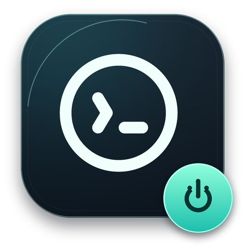

# Codex 悬浮开关与启动前静态 IP 检查

这套 Windows 工具把“打开”和“关闭”合并成一个桌面悬浮按钮。源文件和图标来自原电脑当前使用的版本；安装脚本用于在另一台电脑重新编译并配置快捷方式。



## 按钮的行为

| 场景 | 行为 |
| --- | --- |
| 登录 Windows | 只显示悬浮按钮，不自动打开 Codex 主程序 |
| Codex 已关闭，点击按钮 | 先检测实际出口 IP |
| 出口为 `82.26.250.63` | 直接打开 Codex |
| 出口为其他 IP | 显示当前 IP 和预期 IP，询问是否仍要打开 |
| 检测超时、失败或结果无效 | 提示“未能确认”，询问是否仍要打开 |
| Codex 正在运行，点击按钮 | 先询问是否彻底关闭；确认后清理主程序及相关后台进程 |
| 在任何确认框中取消 | 不执行相应的打开或关闭操作 |
| 右键退出悬浮按钮 | 只退出按钮，Codex 的运行状态保持不变 |

确认框默认选中“否”。右键菜单中的“打开”和“彻底关闭”使用相同的检查、确认逻辑。

按钮可拖动，默认置顶显示。绿色小圆点表示 Codex 正在运行，灰色表示未运行，黄色表示正在检查或执行操作。

## 在另一台电脑安装

准备条件：Windows 10/11 x64、已安装 Windows 桌面版 Codex，以及系统自带的 Windows PowerShell 5.1 和 .NET Framework C# 编译器。无需另外安装 Visual Studio。

1. 克隆或更新此仓库，保留本目录的完整文件。
2. 先按上一级的 [静态 IP 配置方案](../README.md) 配置 Clash，开启系统代理，确认 AI 分组已选择静态出口。
3. 打开 PowerShell，运行：

```powershell
powershell.exe -NoProfile -ExecutionPolicy Bypass -File "C:\github\software\梯子\Codex悬浮开关\Install-CodexToggle.ps1"
```

安装脚本会：

- 在临时目录编译悬浮按钮，安装到 `%LOCALAPPDATA%\CodexToggle`。
- 创建桌面“Codex 开关”快捷方式和开机“Codex 悬浮开关”快捷方式，两者都只启动按钮。
- 关闭当前用户 Codex 安装包自带的开机启动项，避免主程序绕过按钮自动打开。
- 显示悬浮按钮；保持 Codex 主程序当前的运行状态。
- 在安装目录的 `backups` 下备份已有文件、快捷方式和修改前的启动项状态。

再次安装时，只替换本工具在目标目录中的悬浮按钮进程。已有的按钮位置设置会保留；已有静态 IP 设置在没有显式传入新 IP 时也会保留。

如果暂时不想显示按钮，可加 `-NoLaunch`，安装完成后再双击桌面快捷方式：

```powershell
powershell.exe -NoProfile -ExecutionPolicy Bypass -File "C:\github\software\梯子\Codex悬浮开关\Install-CodexToggle.ps1" -NoLaunch
```

## 静态 IP 检查如何工作

打开 Codex 前，按钮使用 Windows 当前系统代理请求：

```text
https://chatgpt.com/cdn-cgi/trace
```

从响应中的 `ip=` 读取实际出口，与 `network-settings.json` 中的预期值比较：

```json
{
  "ExpectedStaticIp": "82.26.250.63"
}
```

使用 ChatGPT 域名是为了让这个请求命中 Clash 的 AI 规则，而不是依据界面里选中的节点名称判断。请求超时约 6 秒，整体另有约 7.5 秒的取消保护。

此检查只判断本次观测的 IP 是否与配置相同。它不判断代理套餐是否属于静态 IP，也不保证随后每个请求都不掉线。Codex 仍需配置为使用同一系统代理和相应路由规则。

更换静态出口时，可修改安装目录中的 `network-settings.json`，也可重新安装时显式指定：

```powershell
powershell.exe -NoProfile -ExecutionPolicy Bypass -File "C:\github\software\梯子\Codex悬浮开关\Install-CodexToggle.ps1" -ExpectedStaticIp "82.26.250.63"
```

检测不需要代理账号密码；认证由本机 Clash 配置完成。本目录不包含 Codex 登录态。

## 开机只显示按钮

需要区分两个独立的启动入口：

1. Windows/Codex 安装包自带的主程序开机启动：关闭。
2. 本工具的悬浮按钮开机启动：开启。

安装脚本会分别处理。按钮右键的“开机显示悬浮按钮”只控制第 2 项；它不会打开 Codex。以后若在 Codex 或 Windows 设置中重新启用主程序自启，仍可能绕过本按钮，应再次关闭。

当前用户按钮的开机快捷方式位于：

```text
%APPDATA%\Microsoft\Windows\Start Menu\Programs\Startup\Codex 悬浮开关.lnk
```

安装脚本没有设置任何“开机自动打开 Codex”的后台任务。安装时使用的无触发器临时计划任务仅用于独立启动悬浮按钮，随后删除任务注册；日常开机依靠上面的快捷方式。

## 关闭进程的范围

工具按 Codex 安装路径、相关运行时/插件路径及进程父子关系识别目标，保护悬浮按钮自身及其工作进程，并核对进程创建时间以避免 PID 复用误判。它不会使用“结束所有 node/python/浏览器进程”的做法。

确认关闭后，正在执行的 Codex 任务会被中断。单独残留的渲染器、插件或后台引擎不会被当成“Codex 窗口已打开”。

打开或关闭 Codex 都应通过悬浮按钮。`CodexToggle.ps1` 是内部执行脚本；直接调用它会绕过按钮里的网络检查和确认框。

## 验证与诊断

只编译并运行自测，不安装、不创建快捷方式、不修改启动项、不打开或关闭真实 Codex：

```powershell
powershell.exe -NoProfile -ExecutionPolicy Bypass -File "C:\github\software\梯子\Codex悬浮开关\Install-CodexToggle.ps1" -ValidateOnly
```

验证覆盖确认/取消分支、IP 分类、主窗口识别、相关进程范围及 PID 复用保护。进程关闭测试只创建并结束专用的三个临时工作进程。

安装后的诊断文件位于 `%LOCALAPPDATA%\CodexToggle`：

| 文件 | 用途 |
| --- | --- |
| `network-settings.json` | 预期静态 IP |
| `widget-settings.json` | 位置和置顶设置 |
| `last-network-check.json` | 最近一次出口检查结果 |
| `activity.log`、`last-action.json` | 打开/关闭执行记录 |
| `last-error.json`、`widget-error.log` | 执行异常 |
| `installation.json` | 安装位置、快捷方式及备份位置 |

如果看不到按钮，双击桌面“Codex 开关”，已有按钮会回到屏幕右侧。若启动检查报 IP 不符，先检查 Clash 的 AI 分组和真实出口，再决定是否允许本次打开。

## 源文件

- `CodexWidget.cs`：悬浮 UI、状态识别、右键菜单、鼠标拖动与确认入口。
- `CodexSafety.cs`：出口检测、IP 分类和操作确认。
- `CodexToggle.ps1`、`CodexProcesses.ps1`：后台打开/关闭与进程识别。
- `CodexToggle.ico`、`CodexToggle.png`：窗口、快捷方式和悬浮图标。
- `Test-CodexSafety.cs`、`Test-CodexToggle.ps1`：已有逻辑的回归自测。
- `Install-CodexToggle.ps1`：另一台电脑的编译、安装与启动项配置。

该版本针对当前使用的 Windows 安装包版 Codex。其他安装形式可能需要调整主进程识别与启动方法。

## 停用

右键退出按钮，并取消“开机显示悬浮按钮”，或删除上述开机快捷方式。桌面的“Codex 开关”快捷方式也可手动删除。

这些操作不会卸载 Codex。若需回退本工具文件或快捷方式，可从安装目录的 `backups` 复制对应备份；Codex 主程序的开机启动仍建议保持关闭，以便每次打开前先检查出口。
